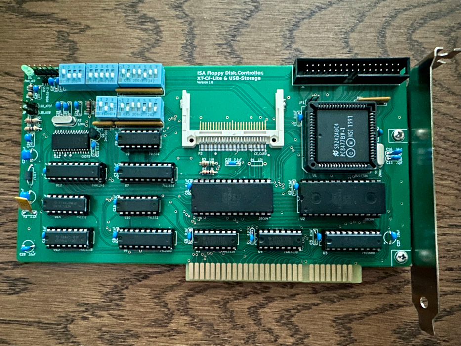

# ISA FDC, XT-CF, USB Card

This is an IBM XT-compatible FDC, XT-CF-Lite and USB card, based on a design (FDC & XT-CF-Lite-V4) by [Sergey Kiselev](https://github.com/skiselev).

# The Idea

The goal of this project is to create an XT-compatible computer on a passive backplane with a modular card-based architecture, minimizing the overall footprint while providing support for all common expansion cards.

# Hardware Documentation
Schematic PDF:
[Schematic - Version 1.0](isa_FDC-CF-USB_Schematic.pdf)

PCB PDF:
[Board Design - Version 1.0](isa_FDC-CF-USB_Board_Design.pdf)

Gerber Files:
[Gerber- Version 1.0](gerber/)

# Bill of Materials
    
coming soon...

# Release Notes

### Changes:

#### Version 1.0

 * Initial Release

 # Benchmarks

### Checkit 3.0 Benchmark:

#### @9.55 MHz
 * XT-CF: 725KB/s

 
# Final Note
 * The card is tested and works.
 * This card won't fit Sergey's case ([this one](https://github.com/skiselev/micro_8088_case)). The case will need to be enlarged.
 * Card size 185.3 mm x 102.9 mm
